# Procedural Exposure Bias in Skill-Augmented Language Model Agents

Source code for our paper:
[Procedural Exposure Bias in Skill-Augmented Language Model Agents](https://arxiv.org/abs/2610.26062)

👉 Click the links below to view our paper and dataset:

<a href="https://arxiv.org/abs/2610.26062"></a><a href="https://huggingface.co/datasets/Zoe-Mango/Vis-Skill-Dataset"></a>

If you find this work useful, please cite our paper and give us a shining star 🌟
```
@misc{yang2026proceduralexposurebiasskillaugmented,
      title={Procedural Exposure Bias in Skill-Augmented Language Model Agents}, 
      author={Qing Yang and Yuqi Xiong and Pengcheng Huang and Zhipeng Xu and Zhenghao Liu and Zulong Chen and Yu Gu and Ge Yu},
      year={2026},
      eprint={2610.26062},
      archivePrefix={arXiv},
      primaryClass={cs.CV},
      url={https://arxiv.org/abs/2610.26062}, 
}
```

## 📖 Overview
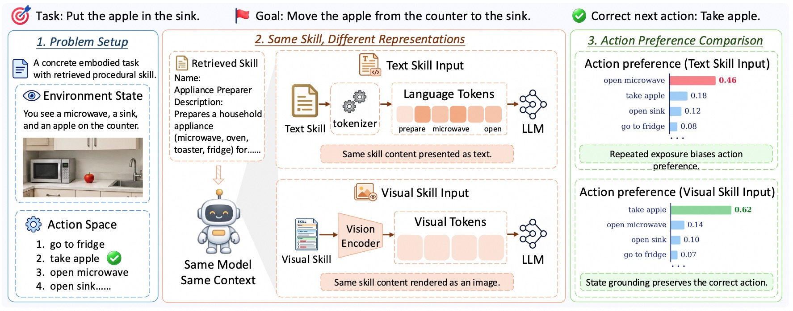
This work studies how the representation of skills affects LLM agents. Skills are reusable procedural documents (SKILL.md) that describe how to solve a family of tasks. For each task instance, Qwen3.8-Max selects the top-5 skills, and the agent receives them either as text (Text Skills) or rendered as structured image cards (Visual Skills). We evaluate both settings on ALFWorld, ScienceWorld and WebShop with Qwen3.5-9B, Qwen3.5-27B, Gemma-4-31B-it and Kimi-K2.5. We further identify Procedural Exposure Bias (PEB): when the keyword of an action is repeated in the skill, the agent is pulled toward that action even when it is not applicable in the current state. Our analyses follow PEB from token probabilities to generated actions, and locate where it arises inside the model with logit lens and component patching.

## ⚙️ Set Up
**Use `git clone` to download this project**
```
git clone https://github.com/NEUIR/Vis-Skill.git
cd Vis-Skill
```
**To prevent conflicts between packages, we use one environment per benchmark and backbone family. All environment files are in `envs/`.**
```
for ALFWorld (Qwen3.5, Kimi-K2.5) and the Qwen3.5-9B analyses, please:
conda env create -f envs/environment_alfworld.yml

for ALFWorld (Gemma-4-31B-it) and the Gemma-4-31B-it analyses, please:
conda env create -f envs/environment_alfworld_gemma.yml

for ScienceWorld (Qwen3.5, Kimi-K2.5) and plotting, please:
conda env create -f envs/environment_scienceworld.yml

for ScienceWorld (Gemma-4-31B-it) and Gemma-4-31B-it component patching, please:
conda env create -f envs/environment_scienceworld_gemma.yml

for WebShop, please:
conda env create -f envs/environment_webshop.yml          # Qwen3.5, Kimi-K2.5
conda env create -f envs/environment_webshop_gemma.yml    # Gemma-4-31B-it

for Qwen3.5-9B component patching, please:
conda env create -f envs/environment_mechanism_py312.yml
```

## 📦 Data
Download the ALFWorld and WebShop files from our [HuggingFace dataset](https://huggingface.co/datasets/Zoe-Mango/Vis-Skill-Dataset) into the `data/` directory, and link them into the experiment folders:
```
hf download Zoe-Mango/Vis-Skill-Dataset --repo-type dataset --local-dir data
bash scripts/setup_data.sh
```
```
data/
- alfworld/   # ALFWorld valid_unseen split (134 test games) and logic files
- webshop/    # WebShop product files and the prebuilt search index
```
❗️Note: ScienceWorld needs no download. It is installed with the environment (`pip install scienceworld`) and needs Java 1.8 or newer on `PATH`, e.g. `conda install -c conda-forge openjdk=11`.

## 🤖 Models
Download Qwen3.5-9B, Qwen3.5-27B and Gemma-4-31B-it from HuggingFace into `models/Qwen3.5-9B`, `models/Qwen3.5-27B` and `models/Gemma-4-31B-it`. They are served locally with vLLM. Kimi-K2.5 and the Qwen3.8-Max annotation are called through DashScope, please set your own API key:
```
export DASHSCOPE_API_KEY=<your-key>
```

## 🚀 Running the Main Experiments
**🏷️ Skill annotation (optional):**
```
python annotation/annotate_alfworld_skills.py
python annotation/annotate_science_skills.py
python annotation/annotate_webshop_skills.py
```
❗️Note: The annotations used in the paper are already provided in `annotation/outputs/`. Run this step only if you want to annotate again.

**🖼️ Render the visual skill cards:**
Run this once before any Visual Skill experiment. The cards are copied into every `vis-skill/` folder.
```
bash scripts/render_skill_cards.sh
```
**🏃 Run the experiments:**
Each `experiments/<benchmark>/<backbone>/run_all.sh` runs No Skill, Text Skill and Visual Skill for one backbone. The backbone can be `qwen3.5-9b`, `qwen3.5-27b`, `gemma-4-31b` or `kimi-k2.5`.
```
bash experiments/alfworld/qwen3.5-9b/run_all.sh
bash experiments/scienceworld/qwen3.5-9b/run_all.sh
bash experiments/webshop/qwen3.5-9b/run_all.sh
```
To run a single setting, e.g. ALFWorld Text Skill with Qwen3.5-9B:
```
cd experiments/alfworld/qwen3.5-9b/text-skill
bash start_vllm.sh && bash launch.sh && bash stop_vllm.sh
```
**🛒 Top-k skill ablation on WebShop (Qwen3.5 only):**
```
bash experiments/webshop/qwen3.5-9b/text-skill/topk/run_all.sh
bash experiments/webshop/qwen3.5-9b/vis-skill/topk/run_all.sh
```
📁 Results are saved to the `results/` directory of each setting.

<p align="center">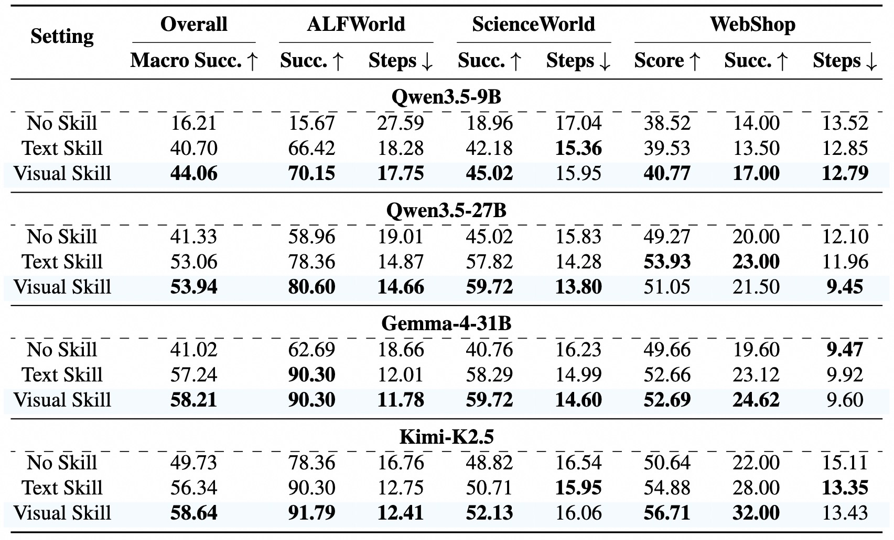</p>
<p align="center"><b>Overall results of No Skill, Text Skill and Visual Skill.</b></p>

## 🔍 Analyzing Procedural Exposure Bias
All analyses are on ALFWorld and are built from the trajectories of the Qwen3.5-9B Text Skill and Visual Skill runs, so please run `experiments/alfworld/qwen3.5-9b/run_all.sh` first. The detailed run order is in [`analysis/README.md`](analysis/README.md).

**🔁 Lexical interference:**
A distractor keyword is injected k = 0, 1, 2, 4, 8 times into the skill document, and the probability of the distractor action is measured under Text and Visual Skills.
```
bash analysis/alfworld-qwen3.5-9b/lexical-interference/run_full.sh
cd analysis/alfworld-qwen3.5-9b/lexical-interference
python paper_figures/plot_fig1a_lexical_interference.py --per_trial results/analysis/per_trial.csv --backbone 9b
python paper_figures/plot_fig1b_delta_p_distribution.py --per_trial results/analysis/per_trial.csv --panels abc
```

**✂️ Causal keyword ablation:**
At k = 4 and 8, only the distractor keyword is replaced (counterfactual), or a frequency-matched unrelated word is replaced (matched control). Run lexical interference first.
```
bash analysis/alfworld-qwen3.5-9b/causal-keyword-ablation/run_full.sh
cd analysis/alfworld-qwen3.5-9b/causal-keyword-ablation
python paper_figures/plot_fig1c_causal_keyword_ablation.py --per_trial results/analysis/per_trial.csv --backbone 9b
```

<table>
  <tr>
    <td align="center" width="32.3%">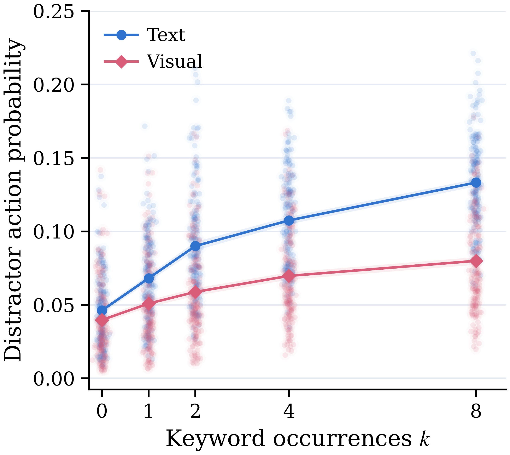<br>(a) Exposure-Dependent Distractor Preference</td>
    <td align="center" width="34.3%">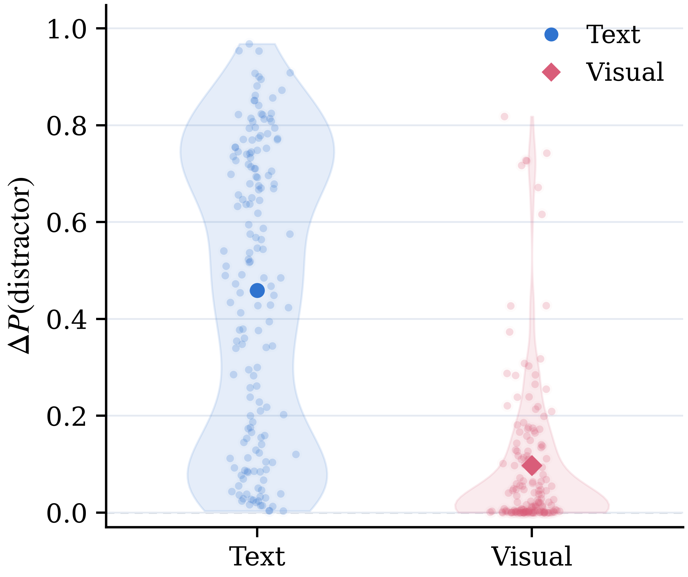<br>(b) Paired Changes in Distractor Preference</td>
    <td align="center" width="33.4%">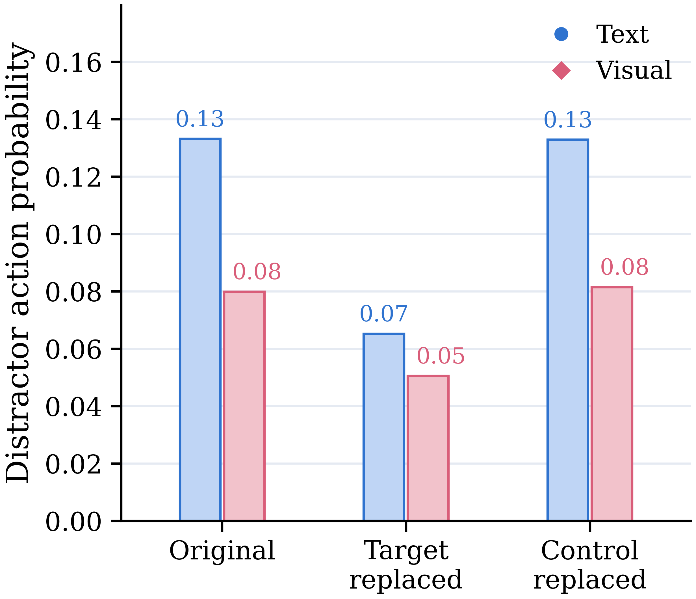<br>(c) Keyword-Replacement Controls</td>
  </tr>
</table>
<p align="center"><b>Procedural Exposure Bias in Qwen3.5-9B under Text and Visual Skills.</b></p>

**🖨️ Rasterized interference:**
The same k-controlled document is also rendered as a plain-text screenshot, to separate the effect of the visual modality from that of the card structure. Run lexical interference first.
```
bash analysis/alfworld-qwen3.5-9b/rasterized-interference/run_full.sh
cd analysis/alfworld-qwen3.5-9b/rasterized-interference
python paper_figures/plot_fig3a_rasterized_interference.py --palette house --per_trial
```

**👀 Repeated-signal readout:**
```
bash analysis/alfworld-qwen3.5-9b/mechanism/symbol-encoding/launch.sh
bash analysis/alfworld-gemma-4-31b/mechanism/symbol-encoding/launch.sh
python analysis/alfworld-qwen3.5-9b/mechanism/symbol-encoding/paper_figures/plot_fig3b_symbol_readout.py
```

**🎯 Executable action selection:**
```
bash analysis/alfworld-qwen3.5-9b/probability-to-behavior/run_full.sh
bash analysis/alfworld-gemma-4-31b/probability-to-behavior/run_full.sh
python analysis/alfworld-qwen3.5-9b/probability-to-behavior/paper_figures/plot_fig3c_behavioral_realization.py
```

<table>
  <tr>
    <td align="center" width="33%">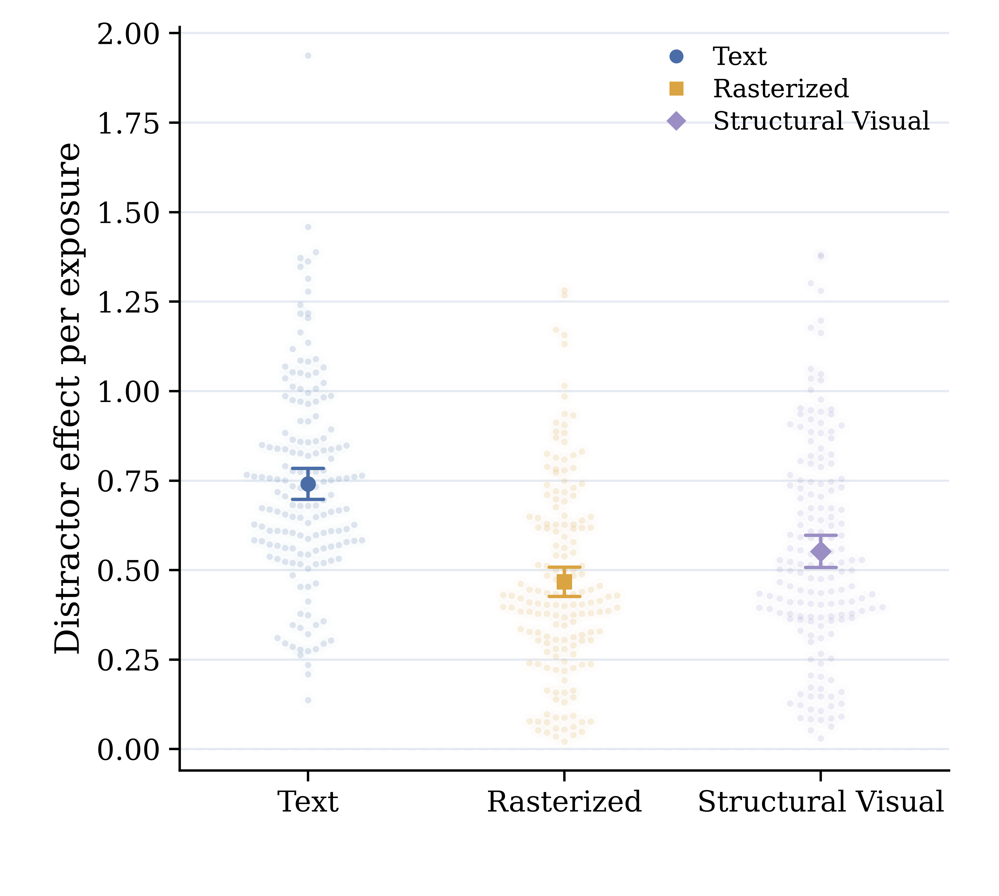<br>(a) Encoding Pathway Intervention</td>
    <td align="center" width="33%">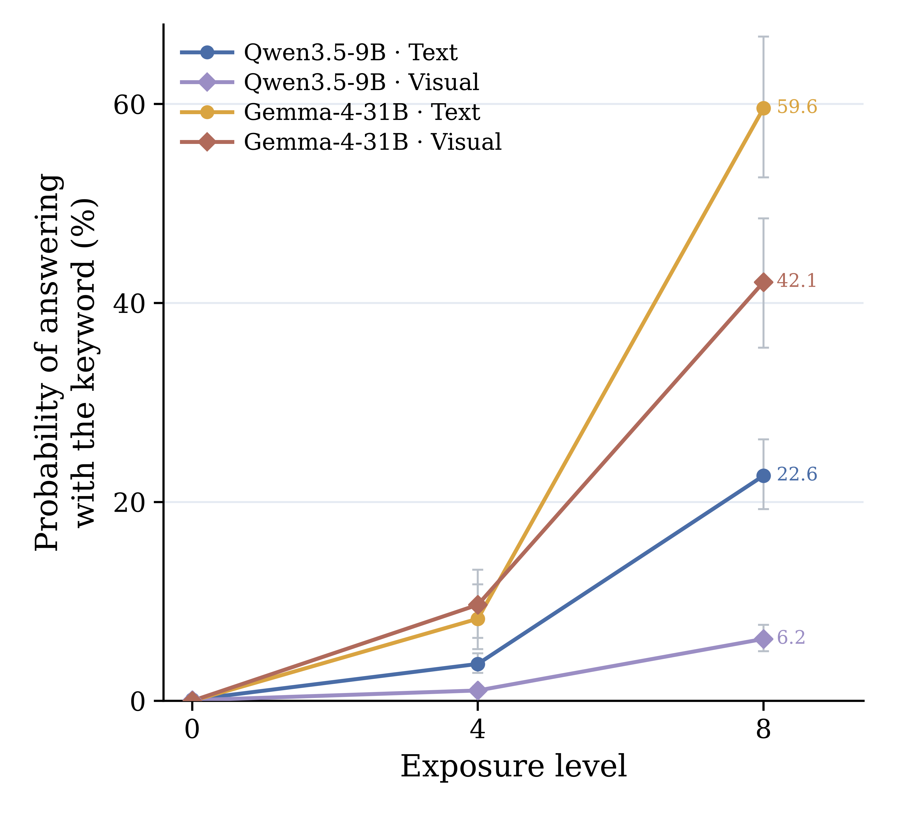<br>(b) Repeated Signal Accessibility</td>
    <td align="center" width="33%">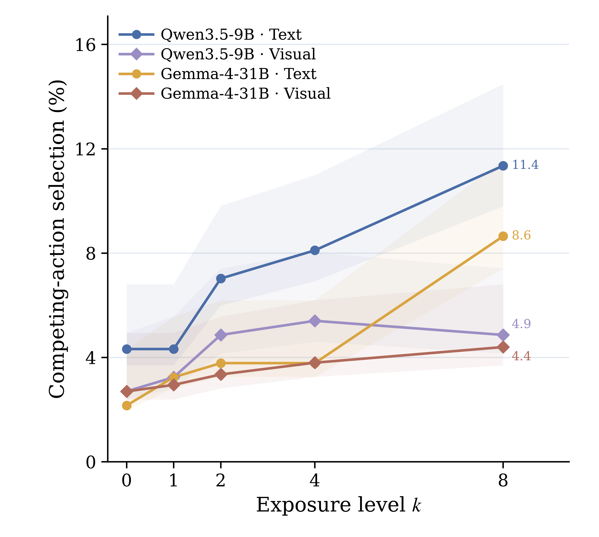<br>(c) Executable Action Selection</td>
  </tr>
</table>
<p align="center"><b>Representation-dependent effects of procedural exposure.</b></p>

**🔬 Logit lens:**
The hidden state after every layer of Qwen3.5-9B is decoded with the model's own final norm and LM head, and the exposure slope of the action evidence is fitted per layer. Run lexical interference and causal keyword ablation first.
```
bash analysis/alfworld-qwen3.5-9b/mechanism/layerwise-exposure-slope/launch.sh
cd analysis/alfworld-qwen3.5-9b/mechanism/layerwise-exposure-slope
python paper_figures/plot_fig4_logit_lens.py --mode norm --from_results
```

<table>
  <tr>
    <td align="center" width="50%">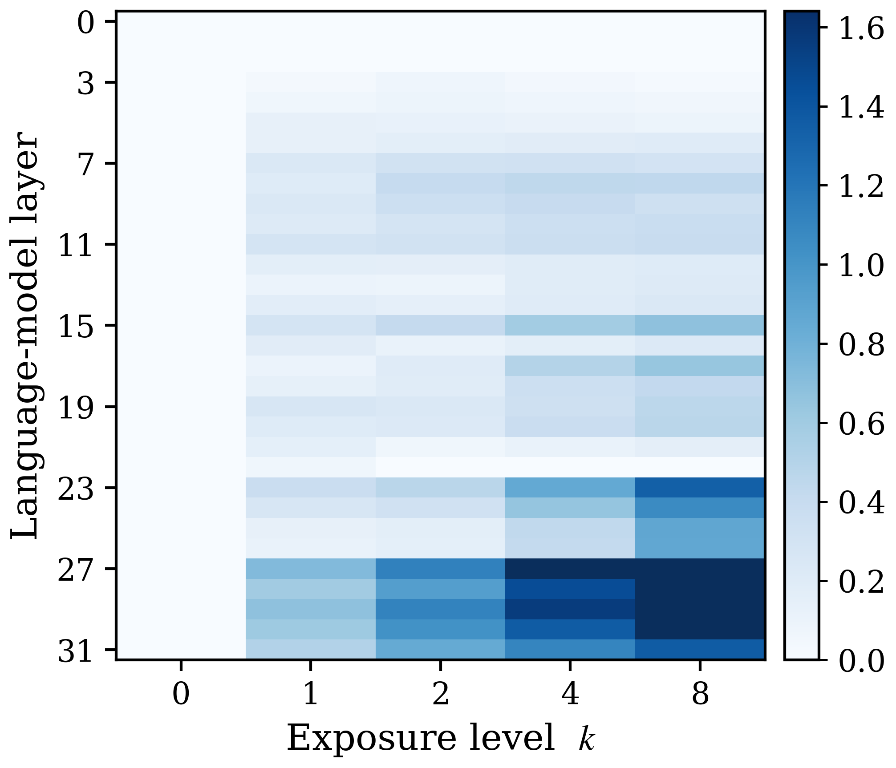<br>(a) Text</td>
    <td align="center" width="50%">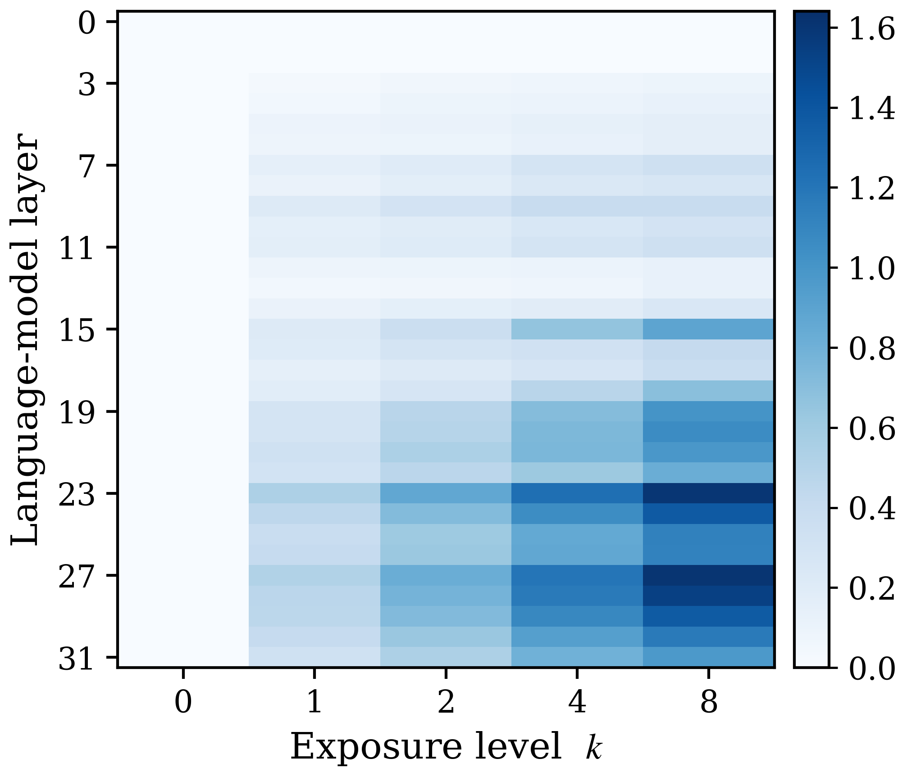<br>(b) Visual</td>
  </tr>
</table>
<p align="center"><b>Layer-wise readout of exposure-dependent action evidence in Qwen3.5-9B.</b></p>

**🧠 Component patching:**
The token-mixer or MLP outputs of the k = 8 run are patched into the k = 0 run, and the recovered part of the exposure effect is measured on Qwen3.5-9B (`envs/environment_mechanism_py312.yml`) and Gemma-4-31B-it (`envs/environment_scienceworld_gemma.yml`). The analysis reads the results of both models, so run it after both runs finish.
```
bash analysis/alfworld-qwen3.5-9b/mechanism/component-patching/launch.sh
bash analysis/alfworld-gemma-4-31b/mechanism/component-patching/launch.sh
cd analysis/alfworld-qwen3.5-9b/mechanism/component-patching
python analyze_component_patch.py
python paper_figures/plot_fig5_component_patching.py --from_results
```

<table>
  <tr>
    <td align="center" width="50%">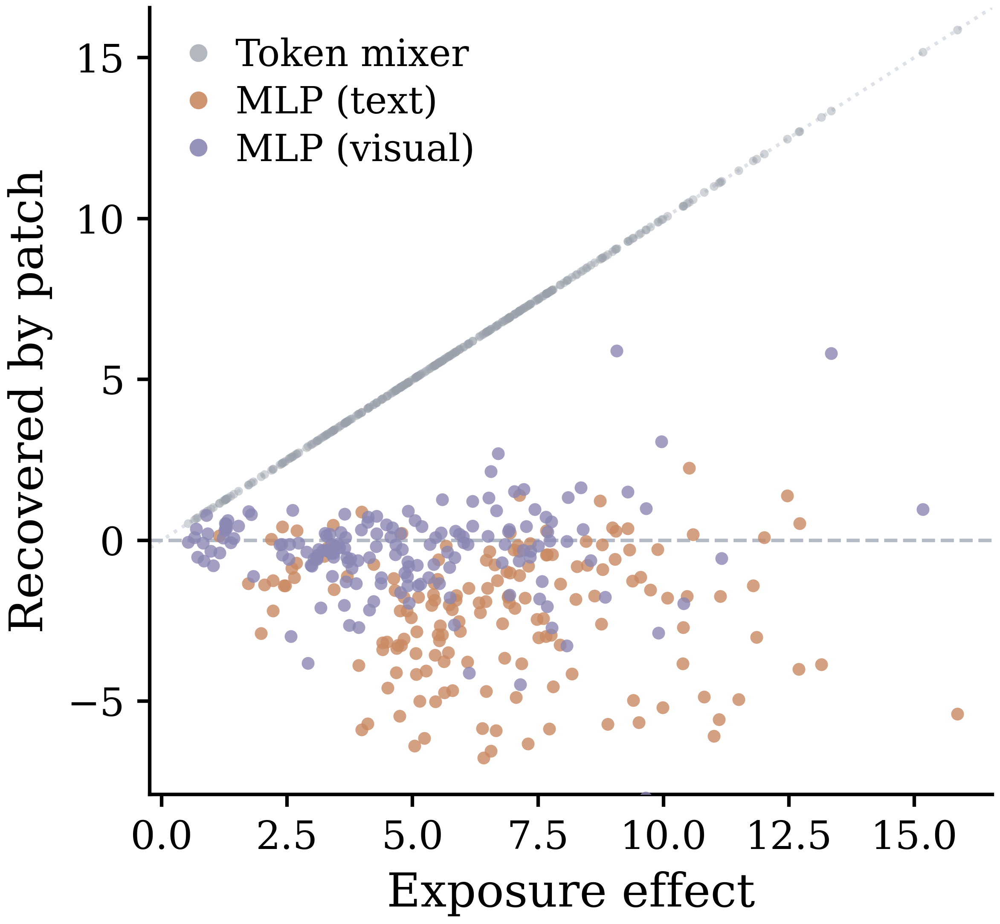<br>(a) Qwen3.5-9B</td>
    <td align="center" width="50%">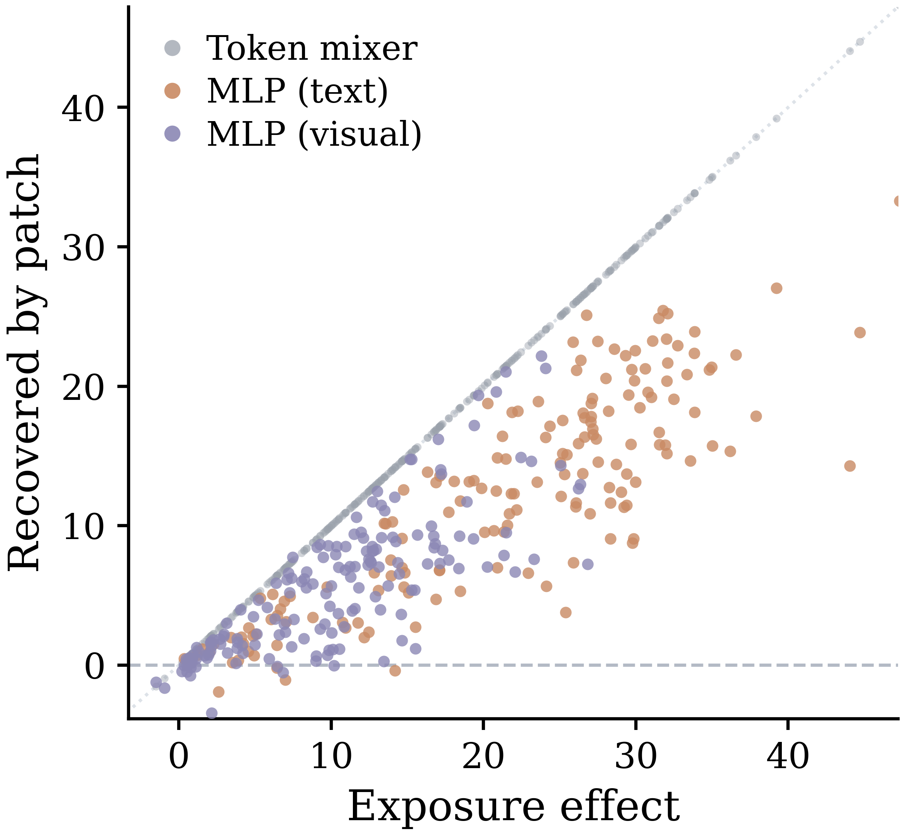<br>(b) Gemma-4-31B-it</td>
  </tr>
</table>
<p align="center"><b>Component intervention under controlled procedural exposure.</b></p>

**📊 Plotting the figures:**
The plotting scripts contain no data: each one reads the result files written by the analyses above (default paths point into this repository), so run those analyses first. All figures are then regenerated with:
```
bash scripts/make_figures.sh
```

## 🙏 Acknowledgements
Our agent pipeline builds on [SkillNet](https://github.com/zjunlp/SkillNet). The WebShop simulator is from [WebShop](https://github.com/princeton-nlp/WebShop). We also use [ALFWorld](https://github.com/alfworld/alfworld) and [ScienceWorld](https://github.com/allenai/ScienceWorld).

## ⚖️ License
This repository is released under the [CC BY 4.0](https://creativecommons.org/licenses/by/4.0/) license. Third-party components keep their original licenses.

## 📬 Contact
If you have questions, suggestions, and bug reports, please email:
```
yangqing_neu@outlook.com
```
